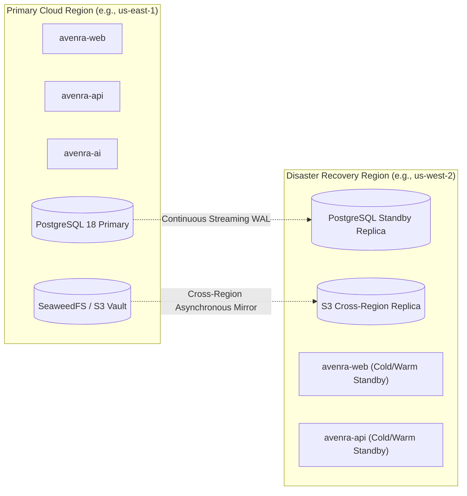

# AVENRA Operations: Disaster Recovery & Business Continuity Plan

> **Document:** Disaster Recovery & Business Continuity Plan (DRP)  
> **Classification:** Engineering & Security  
> **Status:** Production Standard (Phase 13)  
> **Key Metrics:** RTO < 15 minutes | RPO < 5 minutes

---

## 1. Disaster Recovery Architecture



---

## 2. Recovery Objectives

- **Recovery Point Objective (RPO):** < 5 minutes.
  - Achieved through PostgreSQL continuous Write-Ahead Log (WAL) archiving to durable object storage every 60 seconds, combined with synchronous standby replica in a secondary availability zone.
- **Recovery Time Objective (RTO):** < 15 minutes.
  - Achieved through containerized zero-downtime orchestration, automated database failover, and declarative infrastructure scripts.

---

## 3. Automated Backup Cadence

1. **Transactional Database (PostgreSQL):**
   - **Continuous:** WAL archiving shipped to S3/cold vault continuously.
   - **Daily (02:00 UTC):** Full database physical backup via `pg_dump` / `pg_basebackup` with SHA-256 integrity manifest.
   - **Retention:** 30 days point-in-time recovery; monthly snapshots retained for 7 years (compliance archive).
2. **Document & Evidence Vault (S3 / SeaweedFS):**
   - **Continuous:** Write-once-read-many (WORM) bucket policy with automated S3 versioning.
   - **Integrity Validation:** Every stored document has its SHA-256 digest recorded in the database ledger before write confirmation.
3. **Queue & Ephemeral State (Redis):**
   - Background jobs are backed by transactional database state tables (`job_runs`); Redis serves as an in-memory lock coordinator and cache. Loss of Redis does not cause data loss; state is reconstructed from PostgreSQL.

---

## 4. Disaster Recovery Procedure: Failover Walkthrough

### Step 1: Detect and Confirm Primary Region Loss
If primary health probes fail across 3 consecutive checks (90 seconds) and AWS/GCP reports regional disruption:
```bash
# Check primary status
curl -fsS http://api.primary.avenra.internal/healthz || echo "Primary Down"
```

### Step 2: Promote Standby Database to Primary
On the standby database node:
```bash
# In PostgreSQL
pg_ctl promote -D /var/lib/postgresql/data
# Or via cloud managed failover
aws rds failover-db-cluster --db-cluster-identifier avenra-prod-cluster
```

### Step 3: Switch Traffic via DNS / Anycast Routing
Update DNS records (Route 53 / Cloudflare) to route traffic to the DR region edge load balancer:
```bash
# Verify DNS propagation
dig +short api.avenra.com
```

### Step 4: Run Post-Recovery Integrity Validation
Execute the verification test suite:
```bash
bash scripts/backup-recovery-drill.sh --verify-only
```
Check that:
- All tenant RLS boundaries remain strictly enforced.
- Document SHA-256 hashes match database records.
- Background worker resumes unclaimed jobs without duplicates.
