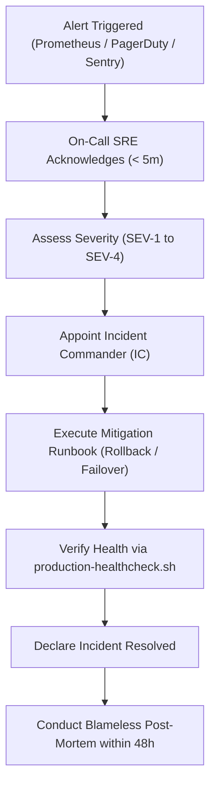

# AVENRA Operations: Incident Response Runbook

> **Document:** Incident Response & Operational Runbook  
> **Classification:** Engineering & Operations (SRE)  
> **Status:** Production Standard (Phase 13)  
> **Target SLA:** 99.95% Availability | RTO < 15 min | RPO < 5 min

---

## 1. Incident Severity Matrix

| Severity | Definition | Target Response (Ack) | Target Mitigation (RTO) | Communication Cadence |
|---|---|:---:|:---:|:---:|
| **SEV-1 (Critical)** | Total platform outage, data corruption, multi-tenant data leak, or complete failure of work execution engine affecting multiple tenants. | **< 5 minutes** | **< 15 minutes** | Updates every 15 min |
| **SEV-2 (Major)** | Degraded core capability: AI extraction offline, webhook deliveries paused, email notifications failing, or single-tenant isolation exception. | **< 15 minutes** | **< 1 hour** | Updates every 30 min |
| **SEV-3 (Moderate)** | Non-blocking feature failure: analytics delay, billing usage sync delayed, isolated UI cosmetic issue, non-critical background retry delay. | **< 1 hour** | **< 8 hours** | Daily update |
| **SEV-4 (Minor)** | Minor documentation discrepancy, cosmetic UI bug not affecting workflow execution, or internal operational task. | **< 1 business day** | Next release cycle | Release notes |

---

## 2. Incident Response Workflow



### Roles During a SEV-1 / SEV-2 Incident
1. **Incident Commander (IC):** Leads triage, coordinates remediation actions, owns final decisions on rollbacks or failovers.
2. **Operations Lead (SRE):** Executes infrastructure changes, queries telemetry (Jaeger traces, Prometheus metrics, Postgres logs).
3. **Communications Lead:** Updates the status page (`status.avenra.com`) and manages customer notifications.

---

## 3. Emergency SOPs (Standard Operating Procedures)

### SOP 3.1: Service Rollback
When a new release introduces regressions:
1. Identify the previous known good Docker image tag or git SHA:
   ```bash
   git log --oneline -n 5
   ```
2. Roll back container deployment immediately:
   ```bash
   docker compose -f infrastructure/docker/compose.prod.yaml down
   # Switch IMAGE_TAG to previous SHA in .env.production
   docker compose -f infrastructure/docker/compose.prod.yaml up -d
   ```
3. Run verification probe:
   ```bash
   bash scripts/production-healthcheck.sh
   ```

### SOP 3.2: Immediate Secret Rotation
In case of leaked credentials or key compromise:
1. **Database Password Rotation:**
   - Update `POSTGRES_APP_PASSWORD` in the secret manager (e.g., AWS Secrets Manager or HashiCorp Vault).
   - Execute password update in PostgreSQL:
     ```sql
     ALTER USER avenra_app WITH PASSWORD '<NEW_STRONG_PASSWORD>';
     ```
   - Restart API pods rolling one-by-one with updated credentials.
2. **JWT Secret Rotation:**
   - Add new key to `AVENRA_AUTH_KEY_RING` (keeping previous key for graceful token expiration window).
   - Set `AVENRA_AUTH_ACTIVE_KEY_ID` to the new key ID.
   - API automatically signs with the new key and verifies existing valid tokens until expiration.
3. **Webhook Signing Secret Rotation:**
   - Trigger secret rotation via `/api/v1/organizations/{id}/integrations/{connectionId}/rotate`.
   - The platform generates a new HMAC secret and informs the subscriber while accepting old signatures during the 24-hour overlap window.

---

## 4. Post-Mortem & Root Cause Analysis (RCA) Template

All SEV-1 and SEV-2 incidents require a blameless post-mortem within 48 hours containing:
- **Timeline (UTC):** Detection, triage, mitigation, resolution.
- **Root Cause:** Direct cause, contributing environmental factors.
- **Impact:** Tenants affected, requests failed, SLA impact percentage.
- **Action Items:** P0 (prevent recurrence within 7 days), P1 (detection improvements within 14 days).
